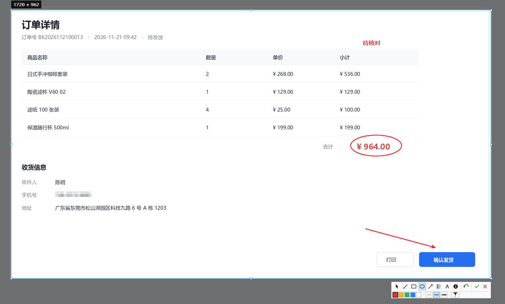
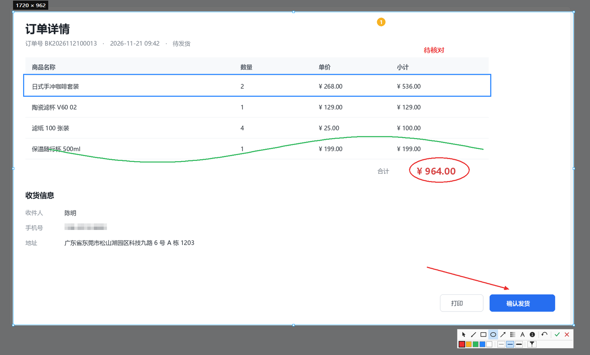
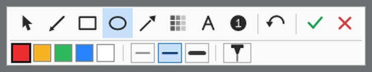

# QuickShot · 轻量截图工具

Windows 上的极简截图工具。**单个 exe 74 KB，常驻内存约 2.8 MB**，纯 Win32 + GDI+ 实现，没有任何第三方运行时依赖。

按下 `Ctrl+Alt+A` 就能框选、标注、复制、保存。



## 功能

**截图**

- 全屏遮罩框选，**松开鼠标后选区仍然保留**，可以继续调整
- 8 个手柄缩放、拖动内部整块平移、方向键微调（`Shift` 加速 10px）
- 确认：`✓` / `回车` / 双击选区
- 取消：`✗` / `Esc` / 右键

**标注**



| 工具 | 说明 |
|---|---|
| 画笔 | 自由圈画，轨迹平滑 |
| 矩形 | 框重点 |
| 椭圆 | 圈出局部 |
| 箭头 | 指向某个位置 |
| 马赛克 | 10×10 色块平均，遮挡密码/姓名/手机号 |
| 文字 | 支持中文输入法，点已有文字可**二次编辑** |
| 序号 | 点一下放一个，编号自动递增，撤销会退号 |

工具条分两行，工具在上、颜色和粗细在下：



- 5 种颜色（红 / 黄 / 绿 / 蓝 / 白）
- 3 档粗细（同时决定字号和序号圆圈大小）
- 撤销：`Ctrl+Z` 或工具条按钮

**其它**

- 确认后自动复制到剪贴板，同时保存到 `图片\Screenshots`
- 钉在屏幕上：把截图钉成悬浮窗，可拖动，右键菜单支持复制 / 另存为 / 关闭
- 托盘菜单可改快捷键（4 套预设）、开关自动保存、设置开机自启

## 构建

需要 **MinGW-w64**（`gcc` 和 `windres` 在 PATH 里）：

```bat
build.bat
```

或手动执行：

```bat
windres app.rc -O coff -o app.res
gcc -O2 -s -Wall -mwindows shot.c app.res -o snapshot.exe ^
    -lgdiplus -lgdi32 -luser32 -lshell32 -lole32 -lcomdlg32 -lm
```

## 使用

1. 双击 `snapshot.exe`，托盘出现图标
2. 按 `Ctrl+Alt+A` 截图
3. 需要常驻开机自启，在托盘图标右键里勾选

## 文件说明

| 文件 | 内容 |
|---|---|
| `shot.c` | 全部源码（约 3000 行，单文件） |
| `app.rc` / `app.ico` | 图标资源 |
| `build.bat` | 一键编译脚本 |
| `docs/` | README 配图 |

`app.res` 和 `snapshot.exe` 是编译产物，不在版本库内。

## 自检

程序内置三个离屏自检，不需要真的截图就能验证渲染链路：

```bat
snapshot.exe --capture-test            :: 把 7 种标注烘焙成 selftest.png
snapshot.exe --toolbar-test            :: 渲染工具条并校验按钮坐标与光标判定
snapshot.exe --demo bg.png out.png     :: 用指定图片合成一张界面示意图
```

## 已知限制

- 仅 Windows（用到 GDI+ 和 Win32 托盘）
- 序号只支持 1~99
- 标注画在选区内部，超出选区的部分会被裁掉
